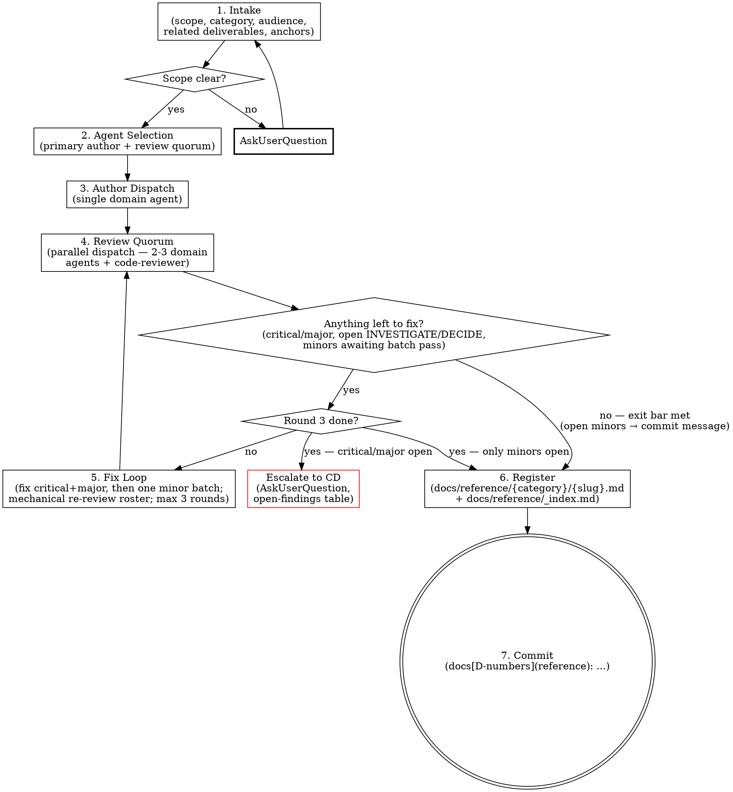

# Reference Doc Creation

Create an internal developer-facing reference doc following z-sdlc conventions. The doc describes how a system works — event schemas, API surfaces, pipeline stage inventories, config matrices, domain gotchas — in a format optimized for coding agents investigating, debugging, or extending that system. Humans read it too; agents are the primary audience.

**Argument:** `$ARGUMENTS` (subject of the doc — system, feature, or concern to document)

## Process



## Collaboration Model

The full model is in `[sdlc-root]/process/collaboration_model.md` (role definitions, decision authority table). The critical directives:

**AskUserQuestion mandate:** every question directed at the user MUST use the `AskUserQuestion` tool — do not type questions as conversational text. All Intake questions must use this tool.

<!-- MIRROR-START: headless-mode.md#headless-stop-rule -->
**Headless runs (no person present).** This run is headless if the caller's prompt or appended system prompt has a line starting `SDLC headless mode:`, or if no ask-the-user tool (`AskUserQuestion`, or the harness's equivalent such as OpenCode's `question`) can be used — none is available or loadable, or a call to it is denied without an answer. A dispatched subagent is never headless itself; in a headless run the orchestrator tells each subagent so, and the limits below bind it too. In a headless run, every point in this skill that asks CD something the next step depends on, waits for CD's approval, or escalates to CD **stops the run there**: save the work so far, return the questions, the document or action plan awaiting approval, or the open-findings table as the run's result (in the caller's output schema if it passed one), and end the turn normally — a stop is a result, not an error. A missing precondition the caller must fix ends the run with status `failed` and the reason. Never guess an answer, take a default for a decision CD owns, approve your own work, or skip the gate. List questions the next step does not depend on in the result instead of stopping. Take the no path on optional offers. Cause no side effect outside the working tree — no push, post, comment, label, publish, external send, or live-system change — unless the caller's prompt names it; list those actions in the result. Two exceptions stand: the skill's own knowledge-layer updates count as local work, even when an adapter writes them to its memory store (a subagent's own memory-store writes don't), and the External Review Gate may send to a hosted provider the project has durably authorized (`[sdlc-root]/process/external-review-gate.md` § Data egress). Reads are fine. A question the prompt or thread already answers is not a gate. Full rule and result format: `[sdlc-root]/process/headless-mode.md`.
<!-- MIRROR-END: headless-mode.md#headless-stop-rule -->

**Anti-patterns to avoid:** (1) code assertion without verification — never answer "how does X work" from memory; grep/read the code first; (2) trajectory poisoning — if the agent is off track after 2-3 corrections, clear context and start fresh.

## Manager Rule

**You are the manager — you orchestrate, you do not implement.** The canonical rule is in `[sdlc-root]/process/manager-rule.md`. Domain agents draft reference docs; domain agents review them. You dispatch and keep the loop moving.

- **Default: dispatch domain agents** for all content authoring and review. You never write reference docs yourself.
- **Failed dispatch:** if an agent returns without applying its work, re-dispatch — do not write it yourself.
- **Session scope:** this rule stays active for the entire session.

## Agent Dispatch Protocol

Dispatch prompts describe WHAT the doc must contain and WHY. HOW to structure sentences, which analogies to pick, which examples to include — those are the author-agent's domain. Pass full scope context (subject, audience, template path, related code anchors) into every dispatch.

**Knowledge routing:** Before dispatching any agent (author or reviewer), consult `[sdlc-root]/knowledge/agent-context-map.yaml` for that agent's entry and include the mapped knowledge files in the dispatch prompt. Read `[sdlc-root]/knowledge/dx/developer-documentation-patterns.yaml` and include it in the author dispatch — it contains documentation architecture patterns (DDP-01 through DDP-08) that directly inform reference doc structure and quality.

---

## Steps

### 1. Intake

Clarify with the user (use `AskUserQuestion` when any of these is ambiguous):

- **Subject** — what system, feature, or concern does this doc describe? (e.g. "auth middleware", "background job registration pattern", "feature flag config matrix")
- **Category** — pick the primary domain. Categories are project-specific; common ones include `api`, `frontend`, `database`, `observability`, `security`, `deploy`, `sdlc`, `cross-cutting`. Use what your project's `docs/reference/` already establishes; if it's a new project, propose a category and confirm with the user.
- **Audience** — is this agent-only or also on-call? Default: `coding-agent` + `developer`. Add `on-call` only if the doc directly supports incident response.
- **Related deliverables** — which D-numbers produced or modified the code being documented? (Used for change log + traceability.)
- **Existing code anchors** — at least one `path:line` the author must read as the source of truth. Never let the author rely on memory.

Confirm the output location: `docs/reference/{category}/{slug}.md`, where `{slug}` is `lowercase-with-hyphens`.

### 2. Agent Selection

Pick the **primary author** based on category. One author writes — consistent voice, coherent narrative. Quorum writing produces checklist-y drafts.

**Use `[sdlc-root]/process/agent-selection.yaml` as the source of truth for which agent owns which domain.** Match the doc's category to the agents whose `dispatch_when` triggers cover that domain. The primary author is the most direct match; the review quorum is 2–3 adjacent-domain agents plus `code-reviewer`.

Quick mapping guidance:

| Doc category | Primary author candidates | Review quorum candidates |
|--------------|---------------------------|--------------------------|
| api | backend-developer | data-architect, security-engineer, code-reviewer |
| frontend | frontend-developer | ui-ux-designer, accessibility-auditor, code-reviewer |
| database | data-architect | backend-developer, performance-engineer, code-reviewer |
| observability | devops-engineer | backend-developer, performance-engineer, code-reviewer |
| security | security-engineer | security-auditor, backend-developer, code-reviewer |
| deploy | devops-engineer | build-engineer, security-engineer, code-reviewer |
| sdlc | (ask user — could be any) | sdlc-reviewer, code-reviewer |
| cross-cutting | (ask user) | all relevant domain agents + code-reviewer |

**Substitute project-specific agents** where the project has them — e.g. a project with a dedicated `search-engineer` should author search-related reference docs with that agent rather than `backend-developer`.

**`code-reviewer` is on every quorum.** Its job on reference docs is template compliance, `path:line` anchor accuracy, broken-link detection, and presence of all mandatory sections.

### 3. Author Dispatch

Consult `[sdlc-root]/knowledge/agent-context-map.yaml` for the primary author's entry. Include the author's mapped knowledge files in the dispatch prompt so domain patterns inform the draft. Read `[sdlc-root]/knowledge/dx/developer-documentation-patterns.yaml` and include it — it defines doc architecture patterns that apply to every reference doc.

The dispatch prompt must include:

1. **Scope statement** — subject, audience, category, output path.
2. **Template path** — `[sdlc-root]/templates/reference_doc_template.md`. The author MUST read the template and follow the section order and frontmatter exactly. No freestyle section headings.
3. **Source-of-truth anchors** — `path:line` ranges the author must read before drafting. Tell the author: "Do not draft from memory. Read every listed file and base the reference on current code."
4. **Audience framing** — "Agents are the primary reader. Favor structure (tables, frontmatter, fixed section order, `path:line` anchors) over prose. A coding agent reading this doc should be able to answer 'how does X work' and 'where do I go in the codebase to change Y' without grepping."
5. **Related deliverables** — D-numbers + result doc paths to read for context.
6. **Plain-language rule for domain terms** — every domain-specific term used in the doc must be defined on first use with a plain-language explanation and a concrete example or analogy. Reference docs are teaching artifacts as much as reference artifacts.
7. **Domain knowledge files** — the author's mapped files from the context-map plus `developer-documentation-patterns.yaml`. Instruction: "Before drafting, read these files for relevant patterns and conventions."

Author output: a complete Markdown file at `docs/reference/{category}/{slug}.md` that (a) validates against the template's frontmatter schema, (b) has every mandatory section filled, (c) contains at least one `path:line` anchor in **Related Code**, and (d) records at least one entry in **Change Log**.

### 4. Review Quorum

Dispatch every agent in the quorum **in parallel** (single message, multiple Agent tool calls). For each reviewer, consult `[sdlc-root]/knowledge/agent-context-map.yaml` for that reviewer's entry and include their mapped knowledge files in the dispatch prompt. Each agent reviews under its own lens — see `[sdlc-root]/process/review-lenses.md` for the canonical per-agent review lens definitions. Pass the lens reference and mapped knowledge files into every reviewer's dispatch prompt so reviewers know which checks are theirs vs. adjacent domains'.

- **Primary-domain reviewers** (not the author) — technical accuracy, completeness of coverage, correctness of examples, currency of gotchas.
- **code-reviewer** — template compliance (frontmatter schema, section presence, section order), `path:line` anchor accuracy (the line ranges must actually contain what the doc claims), broken internal links, markdown validity.

Each reviewer reports findings on the shared severity scale (`[sdlc-root]/process/finding-classification.md` § Severity Levels — impact is measured on a reader acting on what the doc says):

```
critical | doc § section | finding   — a reader acting on the doc would very likely break something (wrong anchor to a destructive path, wrong contract)
major    | doc § section | finding   — significant inaccuracy or missing mandatory content a reader is likely to hit
minor    | doc § section | finding   — partial gap, a workaround exists, or cosmetic
CLEAN: [...]
```

### 5. Fix Loop

Run the review-fix loop from `[sdlc-root]/process/review-fix-loop.md`. The step 4 dispatch is **review round 1**. The roster is the step 4 quorum; this skill's **standing reviewer** is `code-reviewer` (on every quorum), so a narrow re-review is the reviewers who raised the fixed findings plus `code-reviewer`. Reference docs use the shared severity bar as-is — there is no separate HIGH/MEDIUM tier. Findings that calibrate as `minor` do not block the loop: they get one batched fix pass once no critical or major findings remain, and those still open after it go to the Open Minor Findings list (commit message). Classify each finding per `[sdlc-root]/process/finding-classification.md` — reference docs use FIX, INVESTIGATE, and DECIDE. The External Review Gate does not apply to reference docs. Every re-review round emits the `review-fix-loop.md` Step A checklist (`Review round N of 3 — dispatching (full roster | narrow: raisers + standing reviewers):`) before dispatch.

**Snapshot for a new doc.** The doc is usually a new, untracked file. Take the pre- and post-fix snapshots with the temporary-index command in `[sdlc-root]/process/review-fix-loop.md` Step C — it includes untracked files, so `git diff <pre-fix> <post-fix>` shows the doc's fix diff (`git stash create` would miss it).

<!-- MIRROR-START: review-fix-loop.md#code-review-mechanics -->
**Review-fix loop — critical mechanics.** Canonical protocol: `[sdlc-root]/process/review-fix-loop.md`. Shared definitions (severity, deduplication, Open Minor Findings): `[sdlc-root]/process/finding-classification.md`. These steps are inlined so that skipping the read does not skip the behavior.

1. **Verification gate before every round.** Run tests, type checks, lint, and configured static analysis before the first review round and again after every fix round. Fix failures before dispatching reviewers. (Reference docs have no build gate; they skip this step.)
2. **Fresh reviewer subagents, every round.** Dispatch each reviewer as a new subagent in its own context window — never inline, never a resumed reviewer from an earlier round. Re-review prompts include the previous round's findings table and the fix diff, require reading the current artifact rather than recalling it, ask for regressions beyond the prior findings, and state that a clean report is an expected, acceptable outcome. Reviewers report findings only; they never fix. Each reviewer's prompt asks for its findings in its final message only, with no progress updates.
3. **Deduplicate, calibrate, then classify.** Merge duplicates first: the same issue at the same location becomes one finding that keeps the highest reported severity. Then calibrate every severity by impact × likelihood before labelling it. Then classify each finding in the Classification Table. Never downgrade a severity to reach the exit bar.
4. **Fix critical and major findings each round.** Resolve every INVESTIGATE and DECIDE finding. Minor FIX findings wait: once no critical or major findings remain, they get one batched fix pass. Before dispatching any fix, record the pre-fix snapshot — the tree hash printed by `t=$(mktemp); cp "$(git rev-parse --git-dir)/index" "$t"; GIT_INDEX_FILE="$t" git add -A; GIT_INDEX_FILE="$t" git write-tree; rm -f "$t"` (it includes untracked files and never touches the working tree or the real index) — and run the same command after the fixes for the post-fix snapshot.
5. **Re-review roster is mechanical.** After every fix round, including the minor batch pass: if any applied fix was `critical` or `major`, or the touched files (`git diff --name-only` between the pre-fix and post-fix snapshots) go beyond the files named in the fixed findings, dispatch the **full roster**. Otherwise dispatch **only the reviewers who raised the fixed findings, plus the standing reviewers** (code-reviewer and software-architect; for reference docs, the skill's standing reviewer, code-reviewer), scoped to the fix diff. A fix that touches a new domain adds that domain's reviewer. Read the Severity column and compare file sets; do not reason about relevance.
6. **Exit bar.** The loop exits when no `critical` or `major` FIX finding remains open, no INVESTIGATE or DECIDE finding is unresolved, and the accumulated minors have had their one batched fix pass (or the cap leaves no round to re-review it). Minor FIX findings still open go in an **Open Minor Findings** table. They are never silently closed; only CD closes them.
7. **Three-round cap.** At most 3 review rounds per loop: the first round plus up to 2 re-reviews. Every round counts, including the re-review after the minor batch pass and rounds re-opened by External Review Gate findings. At the cap with any `critical` or `major` finding open: stop, escalate to CD via `AskUserQuestion` with the open-findings table, and never claim the loop is clean. At the cap with only minors open: exit with the Open Minor Findings table.
<!-- MIRROR-END: review-fix-loop.md#code-review-mechanics -->

**Fix ownership:** usually the primary author; template/anchor fixes can go to code-reviewer if the finding is mechanical. Fixes passing the Manager Rule's delegation-economics test (e.g., typos, formatting) may be self-applied and are re-reviewed like any other fix; the rest get dispatched with the specific findings list. If an agent returns without applying its fix, re-dispatch with a revised prompt; only a remaining gap that passes the economics test may be closed directly (with review).

**Open minors go in the commit message.** Minor findings still open at loop exit are listed in the commit body (step 7) under `Open minor findings:` — one line each with reviewer, `§ section`, and finding. They are not silently deferred; only CD closes them.

### 6. Register

Once the fix loop exits under its exit bar:

1. Confirm the file is at `docs/reference/{category}/{slug}.md`.
2. Update `docs/reference/_index.md` — add a row to the index table. If the index file does not exist, create it with a header + initial table schema (columns: `Title`, `Category`, `Owner`, `Audience`, `Last Verified`, `Link`).
3. If `docs/reference/` or `docs/reference/{category}/` does not exist yet, create the directory.

**Post-write: offer an explainer or a walkthrough.** Ask CD whether they want an HTML explainer (`sdlc-explain`, **reference** storyboard) or a guided walkthrough (`sdlc-walkthru`) of the reference doc — never unprompted. Mechanics and the precedes-approval rule: `[sdlc-root]/process/html-rendering.md` § Post-Skill Offer.

### 7. Commit

Stage the reference doc + index update + any template-anchor corrections. Commit message format:

```
docs[{D-numbers}](reference): add {slug} reference doc

{1-2 sentences — what system is now documented and why}

Open minor findings:
- [reviewer] § section — finding

Co-Authored-By: {model-name-and-version} <noreply@anthropic.com>
```

Omit the `Open minor findings:` block when none are open. (The `{model-name-and-version}` placeholder follows the repo's current commit convention at author time — do not hardcode a specific model version in this skill; model strings drift.)

If the doc was produced as a follow-up to a specific deliverable, include the D-number in the commit scope so the traceability survives git log.

### 8. Session Learning Capture

Documenting a system forces cross-domain investigation that surfaces knowledge gaps, gotchas, and friction points. The reference doc captures the system's structure, but discipline-level insights (e.g., "no existing knowledge covers this integration pattern", "the architecture makes this domain opaque to adjacent agents", "DX friction in discovering this system's behavior") belong in parking lots.

If this documentation session surfaced non-obvious learnings beyond what the reference doc itself captures, suggest:

> This documentation session surfaced cross-discipline insights worth capturing. Consider running `/sdlc-reflect` to surface them to discipline parking lots.

Skip the suggestion if the documentation was straightforward with no broader insights.

---

## Principles

### Structure over prose

Reference docs are read by agents scanning for specific information. Tables beat paragraphs for enumerable content (event fields, stage lists, endpoint surfaces, config options). Fixed section order means an agent can predict where to find "gotchas" or "examples" without parsing the full doc.

### File:line anchors are mandatory

Every "Related Code" entry must include `path:line` or `path:line-line`. A reference doc that names a function but not its line is a doc that makes the agent grep — which defeats the point. When code moves, update the anchors (the Change Log captures the update).

### Source of truth is code, not memory

The author reads the referenced files before drafting. Reference docs describing stage lists, schemas, or signatures from memory drift within a week. Every round of review-fix reads the current code.

### One author, many reviewers

Quorum writing produces fragmented drafts — each agent optimizes for its lens without a narrative owner. Quorum review catches cross-domain issues in a coherent draft. This mirrors the SDLC-Lite pattern.

### Agents first, humans welcome

Write for an agent that has never seen this code before. If a human reads it too, the structure helps them. If a human finds a section hard to read, an agent will find it harder.

---

## Red Flags

| Thought | Reality |
|---------|---------|
| "I'll write this doc myself — it's just a reference" | Manager Rule. Dispatch the domain author. |
| "One domain agent can author AND review" | The author cannot be in the review quorum. Review catches blind spots the author has. |
| "Skip the review loop — the doc looks clean" | The loop is where `path:line` anchors get verified against current code and cross-domain accuracy surfaces. Run it. |
| "Only the reviewer who raised it needs to re-check the fix" | The re-review roster is mechanical: the full quorum if any fix was critical or major or touched files beyond the findings; otherwise the raisers plus `code-reviewer`. |
| "Round 3 still has a major — the doc is close enough, commit it" | At the cap with critical or major findings open, stop and escalate via `AskUserQuestion` with the open-findings table. Never claim the loop is clean. |
| "Freeform sections are fine for this doc" | No. The template is the contract — section order is how agents find information. Deviations break agent parseability. |
| "File names without line numbers are good enough" | They aren't. DO NOT write `service.py — contains search logic`. Instead write `service.py:1334-1728 — search() instrumented body`. Line numbers are the whole point of the anchor. |
| "The author can draft from memory — they know this domain" | No. The dispatch prompt must require reading the current files. Memory-sourced docs drift within days. |
| "This is a runbook" | Runbooks are procedural responses to specific alerts. Reference docs describe how the system works. If the doc is "when X fires, do Y", it is NOT this skill's output. |
| "This is customer-facing documentation" | This skill writes internal agent-and-developer reference docs. Customer docs live in your project's docs site. |
| "The gotchas list from the D-number result doc is good enough — copy it in" | Copy-paste without re-verification is staleness waiting to happen. The review quorum re-checks gotchas against current code. |
| "I'll register in the index later" | Register in the same commit. Docs that aren't in the catalog go unnoticed by future agents — which defeats the agent-audience goal. |
| "The change log is optional" | It is not. The log records who verified the doc against which commit — the only way to detect drift later. |
| "I'll hardcode the agent matrix in this skill" | No — the matrix lives in `agent-selection.yaml` so it stays consistent with planning and review. If a project adds a domain agent, reference docs in that domain pick them up automatically. |

---

## Additional Resources

- `[sdlc-root]/templates/reference_doc_template.md` — the canonical template. Authors read it before drafting; reviewers check drafts against it.
- `[sdlc-root]/process/agent-selection.yaml` — domain-to-agent mapping used during agent selection. Single source of truth shared with planning and review skills.
- `[sdlc-root]/process/manager-rule.md` — agent-dispatch discipline.
- `[sdlc-root]/process/review-fix-loop.md` — review iteration cadence.
- `[sdlc-root]/process/finding-classification.md` — severity scale, deduplication, classification, Open Minor Findings.
- `[sdlc-root]/process/review-lenses.md` — per-agent review lens definitions.

---

## Integration

- **Depends on:** at least one code artifact to reference (the skill documents existing systems, not proposed ones — proposed systems use `sdlc-plan` / `sdlc-lite-plan`).
- **Feeds into:** `docs/reference/_index.md` catalog; future coding-agent investigations into the documented system; `sdlc-reflect` (suggests it when documentation surfaces cross-discipline insights beyond the reference doc itself).
- **Uses:** domain agents (as author and reviewers), `code-reviewer` (template + anchor verification), `[sdlc-root]/templates/reference_doc_template.md`, `[sdlc-root]/process/agent-selection.yaml`, `[sdlc-root]/process/review-fix-loop.md`, `[sdlc-root]/process/finding-classification.md`.
- **Knowledge routing:** `[sdlc-root]/knowledge/agent-context-map.yaml` (dispatch-time injection for author and reviewers), `[sdlc-root]/knowledge/dx/developer-documentation-patterns.yaml` (author dispatch).
- **Complements:** `sdlc-develop-agent` (agent definitions), `sdlc-develop-skill` (skill definitions), `sdlc-lite-plan` / `sdlc-plan` (produces result docs that reference docs often cite).
- **Does NOT replace:** SDLC result docs (deliverable-bound, archived with the deliverable), customer-facing product docs (project-specific docs site), runbooks (alert-triggered procedural).
- **DRY notes:** a reference doc often cites an SDLC result doc (e.g. "the schema was introduced in D122 — see `docs/current_work/sdlc-lite/completed/d122_.._result.md`"). The reference doc is the long-lived source of truth; the result doc is the deliverable-bound narrative. If content has to live in exactly one place, pick the reference doc.
